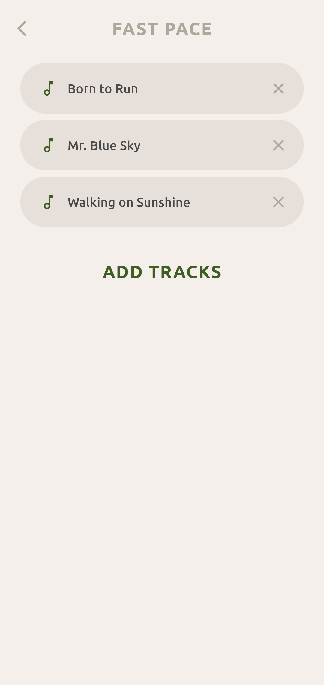
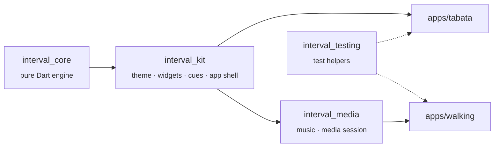

<div align="center">

# Interval Apps

**Free, open-source interval timers for Android and the web.**<br>
No ads, no account, no tracking. Works offline.

[](https://github.com/LLarean/interval-apps/actions/workflows/ci.yml)
[](https://github.com/LLarean/interval-apps/actions/workflows/pages.yml)
[](https://github.com/LLarean/interval-apps/releases/tag/preview)
[](https://flutter.dev)
[](LICENSE)

</div>

## The apps

###  [Tabata Timer](apps/tabata)

The classic protocol — 20 s of work, 10 s of rest, 8 rounds — with every number adjustable.

[Web](https://llarean.org/interval-apps/tabata/) · [APK preview](https://github.com/LLarean/interval-apps/releases/download/preview/tabata-preview.apk) · [RuStore](https://www.rustore.ru/catalog/app/com.LLarean.TabataTimer)

<p align="center">
  &nbsp;&nbsp;&nbsp;
  
</p>

###  [Japanese Walking](apps/walking)

Interval walking: 3 minutes fast, 3 minutes slow, 5 times — a 30-minute session. On Android, plays your own music for each pace and keeps going with the screen off.

[Web](https://llarean.org/interval-apps/walking/) · [APK preview](https://github.com/LLarean/interval-apps/releases/download/preview/walking-preview.apk)

<p align="center">
  &nbsp;&nbsp;&nbsp;
  
</p>

### Both apps

Both apps speak English and Russian, play a sound when the phase changes and keep the screen on while the timer runs.

*APK preview* links point to [test builds of the latest `main`](https://github.com/LLarean/interval-apps/releases/tag/preview). They install next to the store versions as separate "Preview" apps and update each other.

## Why a monorepo

The two apps are separate products with their own store listings, but they share almost everything underneath:



| Path | Contents |
|---|---|
| [`packages/interval_core`](packages/interval_core) | The workout engine: plans, phases and a timer that never drifts. Pure Dart, no Flutter. |
| [`packages/interval_kit`](packages/interval_kit) | Everything the apps share on screen: theme, widgets, sound cues, the workout screen and the app shell. |
| [`packages/interval_media`](packages/interval_media) | Music per pace with cross-fades, and the media session that keeps a workout running with the screen off. Only the walking app uses it. |
| [`packages/interval_testing`](packages/interval_testing) | Helpers for widget tests and README screenshots. |
| [`apps/tabata`](apps/tabata) | The Tabata timer. Settings and phase names only. |
| [`apps/walking`](apps/walking) | The Japanese walking timer. Settings, phase names and the music screens. |

A fix in the engine or a widget lands in both apps with the next build. Read more in [the architecture notes](docs/ARCHITECTURE.md).

## Getting started

You need [Flutter 3.47](https://docs.flutter.dev/get-started/install) — the exact version is pinned in [`pubspec.yaml`](pubspec.yaml) — and, for Android builds, the Android SDK.

```sh
git clone https://github.com/LLarean/interval-apps.git
cd interval-apps
flutter pub get          # resolves the whole workspace at once

cd apps/tabata           # or apps/walking
flutter run -d chrome    # or pick an Android device
```

### Everyday commands

| Task | Command |
|---|---|
| Format | `dart format .` |
| Analyze everything | `flutter analyze` |
| Test the engine | `cd packages/interval_core && dart test` |
| Test a Flutter package or app | `cd <dir> && flutter test` |
| Regenerate screenshots | `cd apps/<app> && flutter test --tags screenshots --run-skipped` |
| Regenerate launcher icons | `cd apps/<app> && dart run flutter_launcher_icons` |
| Build a release | `cd apps/<app> && flutter build apk` / `flutter build web` |

CI runs the same checks on every pull request; see [CONTRIBUTING.md](CONTRIBUTING.md) for the workflow.

## Roadmap

- [x] Tabata timer ported from Unity, with the original look
- [x] Japanese walking timer with sound cues
- [x] Web versions on GitHub Pages
- [x] Walking: separate playlists for fast and slow intervals from the user's own music, cross-faded at every phase change
- [x] Walking: keep running with the screen off (foreground service, lock-screen controls)
- [ ] Voice announcements as an alternative to sounds

## History

The Tabata timer started as a [Unity project](https://github.com/LLarean/tabata-timer). It was rewritten in Flutter to get a much smaller app, a faster web version and native audio features the walking app needs. The design, sounds and settings carried over unchanged.

## Contributing

Bug reports, ideas and pull requests are welcome — start with [CONTRIBUTING.md](CONTRIBUTING.md). Please follow the [code of conduct](CODE_OF_CONDUCT.md), and report security issues privately as described in [SECURITY.md](SECURITY.md).

## Credits and license

Sounds come from [Freesound](https://freesound.org) and the font is [Ubuntu](https://design.ubuntu.com/font); authors and licenses are listed in [CREDITS.md](CREDITS.md).

The code is licensed under the [Apache License 2.0](LICENSE).
